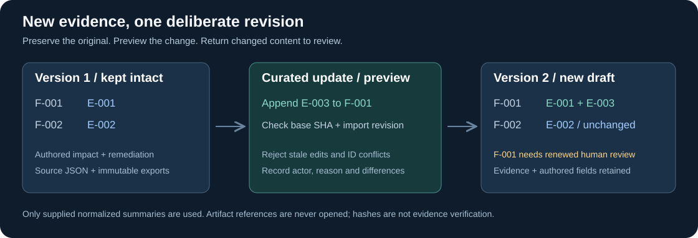
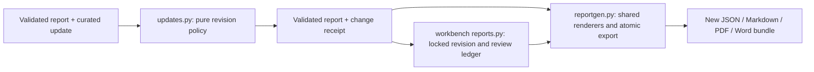

# Update an existing report

Keep one authoritative JSON report and publish a new export for each revision. New synthetic tool output can add evidence to an existing finding, add a finding, or explicitly amend authored fields. Existing evidence, unrelated findings and previous exports stay intact. Raw scanner formats still require human curation into the documented contract; no native adapters, scanning or AI are added.



## A complete demo

Run from the repository root. These commands use invented data and need only Python 3.10+ for Markdown. Use each line separately in PowerShell; on Linux substitute `python3`.

```powershell
python tooling/reporting/reportgen.py tooling/reporting/examples/report-marked.json --output-dir output/report-v1
python tooling/reporting/reportgen.py output/report-v1/input.json --update tooling/reporting/examples/update-evidence.json --preview
python tooling/reporting/reportgen.py output/report-v1/input.json --update tooling/reporting/examples/update-evidence.json --output-dir output/report-v2
```

Expected preview: `modified: true`, `affected_findings: ["F-001"]`, and `changes.evidence.F-001.added: ["E-003"]`. `written: false` confirms preview made no files. Version 2 retains E-001 and F-002, adds E-003 to F-001, and returns F-001 to candidate review. The demo changes no finding description, severity or remediation. Every prior export remains available.

Add `--pdf --docx` to the last command for all formats after preparing [optional dependencies](USER-GUIDE.md#first-report-without-a-network-or-optional-packages).

| Version 2 file | Purpose |
| --- | --- |
| `input.json` | Updated authoritative report for the next revision |
| `report.md`, optional `report.pdf` / `report.docx` | Synchronized views |
| `changes.json` | Receipt: actor/reason, base/result/update hashes, finding and evidence differences |
| `update.json` | Exact supplied update bytes |
| `manifest.json` | Artifact hashes, report identity, original-base byte hash and update lineage |

Inspect `changes.json` before sharing the new draft. Hashes identify bytes/content; they do not establish evidence authenticity or prove findings. Generated Markdown/Word edits do not flow back to JSON. Transfer any manual edits you intend to retain into explicit source-field amendments before regenerating.

## Author the next update

Get the current report identity:

```powershell
python tooling/reporting/reportgen.py output/report-v2/input.json --preview
```

Create a UTF-8 JSON file using the template below. Replace `COPY_CURRENT_REPORT_SHA256` with the preview's 64-character lowercase `report_sha256`. Replace IDs and text deliberately; the placeholder is intentionally not executable. For the unchanged demo fixture, the supplied `examples/update-evidence.json` is ready to run.

```json
{
  "contract_version": "cptc.report-update/1.0",
  "data_category": "synthetic",
  "id": "U-002",
  "engagement_id": "TRAINING-001",
  "base_sha256": "COPY_CURRENT_REPORT_SHA256",
  "actor": "Training analyst",
  "reason": "Record a newly reviewed synthetic response",
  "operations": [
    {
      "op": "append_evidence",
      "finding_id": "F-001",
      "evidence": [
        {
          "id": "E-004",
          "observed_at": "2026-10-16T10:00:00-04:00",
          "collector": "Training analyst",
          "tool": "synthetic-response-fixture",
          "tool_version": "1.0",
          "summary": "Invented second response. No network action occurred.",
          "artifact": "evidence/synthetic-response-2.txt",
          "markings": ["PROPIN"]
        }
      ]
    }
  ]
}
```

The fingerprint is SHA-256 of sorted-key, two-space-indented, Unicode UTF-8 JSON with a final newline. Preview computes it for you. Whitespace, JSON key order and a UTF-8 BOM in an input file do not change this identity; actual JSON value changes do. `manifest.input_sha256` separately identifies the supplied input bytes, which may have different formatting.

Give each effective update its own stable ID. IDs contain 1–64 letters/digits/underscores/hyphens and start with a letter/digit. Actor and reason are required. The engagement must match the current report. Maximum input/update size is 2 MB, at most 200 operations, and the final report still observes its 200-finding/50-evidence-per-finding limits. Unknown envelope/operation/field names are rejected.

### Supported operations

| Operation | Required payload | Effect |
| --- | --- | --- |
| `append_evidence` | `finding_id`, nonempty `evidence` array | Add complete existing-contract evidence objects; retain previous evidence |
| `add_finding` | `finding` | Add a complete finding using the existing report contract; status becomes candidate |
| `amend_finding` | `finding_id`, nonempty `fields` object | Replace only the named authored fields |
| `amend_engagement` | Nonempty `fields` object | Explicitly revise selected report-level prose/date |

Finding amendment fields: `title`, `severity`, `severity_rationale`, `assets`, `description`, `validation_steps`, `business_impact`, `remediation`, `retest_steps`, `cves`, `cvss`. Values replace the entire selected field, including arrays. Existing evidence, IDs, status and markings cannot be replaced through this operation.

Engagement amendment fields: `report_date`, `objective`, `recommendations`, `methodology_sections`, `methodology`, `executive_summary`, `limitations`. Engagement identity/client/team/scope, classification, review metadata and root markings cannot be changed through updates. Schema 1.0 still rejects 1.1-only authored fields; migrate a full source deliberately when required.

Examples to put inside `operations`:

```json
[
  {"op": "amend_finding", "finding_id": "F-001", "fields": {"remediation": "Human-authored revised remediation."}},
  {"op": "amend_engagement", "fields": {"executive_summary": "Revised summary of the supplied synthetic observations."}}
]
```

New evidence uses globally unique IDs within its report. An identical evidence ID/payload on the same finding is a no-op; changed payload or a different owning finding is a conflict. Correct historical evidence by adding a new identified observation and explaining the correction in its summary. Nothing silently deletes or rewrites the original. Adding a finding with an existing ID is a no-op only when its complete content agrees, ignoring candidate/confirmed status.

An effective finding change resets that finding to candidate and clears report-level review; unaffected findings retain their status. A report-level prose change clears report review. Exact no-op amendments/evidence preserve review. The engine never calculates severity, validates a CVE match, verifies a hash or concludes that a failed tool run found nothing. Preserve failed/partial run limitations in human-authored content and workbench run records.

Existing effective handling restrictions remain. New evidence/finding restrictions accumulate under the existing ORCON/PROPIN/PII/PII Red/FI policy; PII Red supersedes PII. Legacy inputs promote to schema 1.2 only when newly supplied structured markings require it. No operation downgrades handling.

## Update a workbench report

Workbench imports deliberately reset findings to candidate. Their working-report fingerprint therefore differs from the original fixture. Use the **working report's** fingerprint and import revision from `report-state`, not the demo patch unchanged.

```powershell
python tooling/workbench/workbench.py init output/review-session --owner "Training owner"
python tooling/workbench/workbench.py import-report output/review-session tooling/reporting/examples/report-marked.json
```

Copy the returned import ID. In the following commands, replace `IMPORT_ID`, `CURRENT_REVISION`, and `my-update.json`. Obtain current state, copy its `report_sha256` into the update envelope, then preview and apply:

```powershell
python tooling/workbench/workbench.py report-state output/review-session IMPORT_ID
python tooling/workbench/workbench.py update-report output/review-session IMPORT_ID my-update.json --base CURRENT_REVISION --preview
python tooling/workbench/workbench.py update-report output/review-session IMPORT_ID my-update.json --base CURRENT_REVISION
python tooling/workbench/workbench.py snapshot output/review-session IMPORT_ID output/review-v2 --pdf --docx
```

The `--base` number is the **import's revision**, not the workspace revision. Preview validates without writing. Apply rechecks identity/revision under the workspace lock. Only affected findings lose accept/reject dispositions. Original imports, previous snapshots, historical reviews and effective update receipts remain. An update cannot introduce a finding ID belonging to another import.

Replaying the same effective update ID and identical payload is a true workbench no-op, including after further review: no revision bump or review reset. Reusing that ID with different content fails. Standalone reporting has no update ledger: reapplying the original patch against revised `input.json` is a stale-base conflict. To check a repeated observation standalone, create a new envelope based on the current report; identical evidence remains a no-op. Workbench no-op envelopes are not added to the effective-update ledger.

Review the changed finding against the latest revision:

```powershell
python tooling/workbench/workbench.py report-state output/review-session IMPORT_ID
python tooling/workbench/workbench.py review output/review-session IMPORT_ID F-001 --decision accept --reason "Reviewed synthetic evidence and authored impact" --reviewer "Training reviewer" --base CURRENT_REVISION
```

Use the revision returned by the immediately preceding state command. Existing review commands without `--base` remain compatible; include it to refuse a stale acceptance. `complete` lists remaining author/review/CVE gaps. Reviewed-training exports still require all applicable checks and do not establish event approval.

Workbench snapshots add `changes.updates` and per-finding evidence differences. `updates.json` contains applied receipts. A new run/incident/retest can update the snapshot appendix without changing findings. The same appendix renders in Markdown, PDF and Word; later snapshots never modify old exports.

## Conflicts and recovery

| Result | What to do |
| --- | --- |
| Stale base fingerprint | Preview current source and compare its changes; reconcile intended operations before creating a rebased envelope |
| Revision conflict | Read current import revision and contents; review intervening edits before retrying |
| Evidence/finding ID conflict | Inspect the existing object; assign a new ID to genuinely new evidence/findings |
| Reused update ID with different payload | Preserve prior receipt and use a new update ID |
| Any invalid operation | Correct the batch; all changes were rejected together |
| Existing output directory | Choose the next version's new directory |
| Missing dependency/font or renderer error | Prepare the local dependency and retry into a new directory; prior bundles remain |
| Release rejected after update | Review changed content, record valid reviewer/date and confirmed/verified decisions in the authoritative source |

Do not replace a stale fingerprint without first reconciling changes. Contract failures leave source/workspace untouched. Render failures publish no partial destination. Workspace publication retains the existing limitation that a complete snapshot may survive a subsequent ledger I/O failure: inspect its manifest/revision before reconciliation.

## Module boundaries



`updates.py` contains identity, operation policy and change calculation, with no filesystem access. Report validation is injected from the reporter, preserving one report contract. The CLI owns reading bounded inputs and rendering; the workbench owns locks, revisions, dispositions and history. Existing render APIs and schemas remain compatible. No native tool importer is implied by the update contract.
