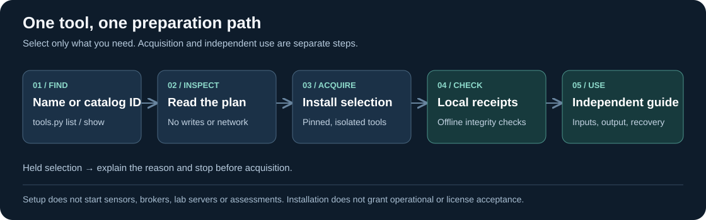

# Prepare one tool or a bundle



Use **Kali Linux amd64**, Python 3.10+ (3.11+ for zigpy), Internet and a trusted, idle installation directory. Docker Engine with Linux containers must already be available for image/lab recipes. Docker Desktop, Windows/RSAT, .NET and Npcap are separate platform prerequisites; this script never installs or starts their services. Windows can use `python tools.py list/show/plan` to inspect preparations. Other acquisition hosts are rejected before changes.

From the repository root, each line is a complete command:

```sh
python3 tools.py list
python3 tools.py show zeek
python3 tools.py plan zeek pip-tools
python3 tools.py install zeek pip-tools
python3 tools.py check zeek pip-tools
```

Use catalog IDs interchangeably, for example `python3 tools.py install TOOL-004`. Multiple selections deduplicate. Inspection and planning are offline and perform no writes or subprocesses. Installation downloads/builds only the selected components and their prerequisites. Checking is passive and offline: metadata, local hashes, Git status, pip consistency and local Docker image inspection. It never runs the prepared assessment tools, captures traffic or starts containers. Upstream binaries/sources/images remain outside Git.

The portable equivalent is `python3 tooling/farmkit/onboard.py COMMAND ...`; after extracting a farmkit ZIP, run that command from the extracted root, or change into `tooling/farmkit` and use `python3 onboard.py COMMAND ...`. Both use the same registry. `--help` lists arguments. The farmkit source package includes this guide, diagram, catalog tool guides and report-update contract. Reporter/export examples below require the full repository or workbench package; the farmkit ZIP contains preparation tooling only.

## One-line bundles and existing installations

```sh
python3 tools.py install --bundle qa
python3 tools.py install --bundle sensors
python3 tools.py install --bundle labs
python3 tools.py install --bundle runner
```

`qa` contains Syft, pip-tools, LibreOffice Writer and the existing reporting dependencies. `sensors` contains TShark and acquired Zeek/Suricata images. `labs` acquires open62541, ChirpStack, zigpy, OpenPLC, FUXA, Node-RED, Conpot and a Mosquitto broker image. It can require several GB and a lengthy Conpot image build. `runner` prepares existing Linux runner package candidates; availability varies by distribution. These bundles are opt-in; the existing `bash install.sh --profile core/full` paths retain their membership and separate inventories. A runner package being available does not create an execution path for it.

Use `--prefix /absolute/trusted/path` on every install/check command to choose another directory; default `.cptc-tools` is ignored by Git. The legacy suite uses `.cptc-suite`. No automatic sharing or importing of old receipts occurs. `--skip-system` verifies pre-provisioned distro dependencies; it does not ignore missing packages. Setup uses sudo only for apt. Python packages live in separate `venvs/SLUG`, native clients in `bin/`, libraries in `lib/` and `include/`, pinned sources in `src/`, build products in `build/`, payloads in `payloads/`, and per-tool receipts in `receipts/SLUG.json`. Container images live in Docker's local image store.

## Independently useful preparation tools

These commands are **separate operator actions**, after onboarding. Use synthetic source trees/reports and fresh local output paths. Generated SBOMs and dependency locks describe what was observed; they do not certify licenses or vulnerabilities.

Create a local CycloneDX SBOM without remote enrichment or startup update checks:

```sh
mkdir -p output/preparation
SYFT_CHECK_FOR_APP_UPDATE=false .cptc-tools/bin/syft scan dir:tooling --config tooling/farmkit/syft-local.yaml --output cyclonedx-json=output/preparation/tooling.cdx.json
```

The source is explicitly a local preparation directory. The included configuration disables enrichment and file-content collection. Review local configuration/environment overrides and keep client data outside this preparation workspace. See [Syft configuration](https://oss.anchore.com/docs/reference/syft/configuration/).

Generate a hash-bearing Python dependency lock using the **same Python minor version and platform as the target environment**:

```sh
mkdir -p output/locks
.cptc-tools/venvs/pip-tools/bin/python -m piptools compile --generate-hashes --output-file output/locks/reporting.txt tooling/farmkit/requirements/reporting.in
```

Repeat for `ot.in`, `cip.in`, `extended.in` or `onboarding.in` as needed. Inputs retain the existing exact top-level pins. Compilation uses the package index during preparation; it is not an offline command. Validate each resulting lock in a fresh matching environment with `python -m pip install --require-hashes -r LOCK.txt`, followed by `python -m pip check`. Do not use pip-sync against shared/system environments. No generated lock is advertised as portable to every OS/Python. [pip-tools documentation](https://pip-tools.pypa.io/en/stable/) explains the environment dependence.

Export a synthetic Word example with the existing reporter, then convert it for page review:

```sh
.cptc-tools/venvs/reporting/bin/python tooling/reporting/reportgen.py tooling/reporting/examples/report.json --output-dir output/word-example --docx
mkdir -p output/word-pages
libreoffice -env:UserInstallation=file:///tmp/cptc-libreoffice-review --headless --convert-to pdf --outdir output/word-pages output/word-example/report.docx
```

Use a fresh absolute `UserInstallation` URI for each review, inspect the generated PDF pages, and retain the original DOCX. The reporting environment does not require LibreOffice. Conversion success does not establish native Microsoft Word pagination. Use [official startup parameters](https://help.libreoffice.org/latest/en-US/text/shared/guide/start_parameters.html) if your distribution changes its launcher.

## Sensors and separate lab preparation

Image recipes pull **Linux amd64 digests**, rather than floating runtime tags. No `docker run`, Compose deployment, rules updater or sensor service is invoked. Zeek is an upstream image. Suricata uses the explicitly identified [jasonish community image](https://github.com/jasonish/docker-suricata), not an OISF official image. Choose rules/configuration separately; no current rules are silently downloaded by this controller.

Receipts list image references and local image IDs. To inspect an acquired image without running it, use `docker image inspect IMAGE_REFERENCE_FROM_RECEIPT`. For offline analysis procedures, inputs, outputs and stop conditions use [the PCAP runbook](RUNBOOKS.md#offline-pcap). Only supplied synthetic captures are suitable for this cloud-assisted preparation workspace. No live capture is added.

ChirpStack acquires the pinned official configuration checkout and all six distinct constituent images. It also writes `labs/chirpstack-images.json`, overriding all seven service image references with the acquired digests. Inspect the composed configuration without starting it:

```sh
docker compose -f .cptc-tools/src/chirpstack/docker-compose.yml -f .cptc-tools/labs/chirpstack-images.json config --images
```

The upstream file contains lab defaults, published ports and restart policies. Review bindings, authentication, network isolation and retention before any separate deployment. No radio hardware is provisioned. open62541 builds a C SDK plus upstream examples with encryption disabled for synthetic fixtures; it is not a production security configuration. OpenPLC v4.3.1, FUXA 1.3.4, Node-RED 5.0.8 and Mosquitto images are acquired without starting their runtimes. Conpot 1.0.0 builds its pinned upstream Dockerfile; base images/transitive build packages are resolved at build time and recorded only by the resulting local image ID. Conpot's BACpypes3 dependency remains subject to the existing license review concern. No published runtime compatibility or license approval is implied.

For library/SDK use, select `venvs/SLUG/bin/python` explicitly; these are separate environments, not one combined site-packages directory. Existing [individual tool guides](../../docs/TOOL-GUIDES.md) and [bounded runbooks](RUNBOOKS.md) describe inputs, interfaces, limitations and independent uses for each protocol. SDKs require an authored client for a particular task; onboarding does not invent a scope-approved client or a native report adapter. Curate synthetic observations into the existing [report update contract](../../docs/REPORT-UPDATES.md).

## Integrity, holds and recovery

The machine-readable registry is [onboarding.json](onboarding.json). Existing source/Python/payload pins come from [install-manifest.json](install-manifest.json); open62541 uses source commit `05c2b389b65cc35884eb40d800301af1f3d130cf` (v1.5.9). Syft 1.54.1 is checked against its release asset size and SHA-256 before reading only the named regular binary/license members. Source notices remain in checkouts; image notices remain in the acquired images; distro/Python notices remain in their installed packages. Distro and Python transitive versions are resolved/recorded, not completely locked. OCI identities were resolved on 16 October 2026. Pins must receive an explicit reviewed update when upstream changes.

Each receipt binds the recipe, legacy manifest and controller/installer source. `check` rejects incomplete receipts, changed source, absent/modified prepared files, dependency drift and missing local images. It is an integrity aid for a trusted prefix, not a signed attestation or protection against concurrent filesystem replacement. Changing controller source or inherited pins requires a new preparation/check record. Save local receipts with your approved workstation image; never upload the downloaded prefix or private outputs to Git.

A selection containing a held tool fails before downloads, package changes or writes, including its other selected tools. Metasploit selection, inactive pycomm3, BACpypes3 licensing and archived OpenDNP3 remain held. PEASS is independently staged, with execution/output aggregation still unaccepted; Impacket can be directly acquired without approving its output integration. Service-bearing runner prerequisites such as rpcbind/nfs-common retain a separate existing-installer route and host service-policy review. Native adapters and broader CI remain deferred.

On failure the command returns nonzero; a started component retains an incomplete receipt. Read the last command/failure and fix prerequisites or temporary network issues. A source directory without HEAD, changed receipt/source, modified binary, partial Syft extraction or stale receipt temporary file is preserved: inspect it and select a new trusted prefix instead of bypassing checks. apt changes are system-wide and not rolled back. The controller never recursively deletes prefixes or Docker images. Removal is a deliberate operator action against the selected prefix/images; uninstalling a prefix does not uninstall distro packages. Confirm availability with `plan` before installing large bundles. [Verification](../../docs/tool-onboarding/verification.md) records actual exercised paths and remaining limits.

## Complete selection matrix

Each slug works in `python3 tools.py show SLUG`, `plan SLUG`, `install SLUG` and `check SLUG`. A held entry explains its reason and refuses installation. The forty catalog rows retain their capability/license dispositions independently of these acquisition methods.

| ID / slug | Tool | Preparation |
| --- | --- | --- |
| `TOOL-001` / `linpeas` | LinPEAS | hash-stage linpeas.sh |
| `TOOL-002` / `winpeas` | WinPEAS | hash-stage winPEASx64.exe |
| `TOOL-003` / `tshark` | Wireshark / TShark | distro: tshark |
| `TOOL-004` / `zeek` | Zeek | acquire zeek/zeek:8.0.3 |
| `TOOL-005` / `suricata` | Suricata | acquire jasonish/suricata:8.0.2 |
| `TOOL-006` / `scapy` | Scapy | scapy==2.8.0 |
| `TOOL-007` / `enum4linux-ng` | enum4linux-ng | distro: enum4linux-ng |
| `TOOL-008` / `netexec` | NetExec | distro: netexec |
| `TOOL-009` / `impacket` | Impacket | distro: python3-impacket |
| `TOOL-010` / `testssl` | testssl.sh | distro: testssl.sh |
| `TOOL-011` / `ffuf` | ffuf | distro: ffuf |
| `TOOL-012` / `metasploit` | Metasploit Framework | **held**: Metasploit components/modules require separate selection and license review. |
| `TOOL-013` / `pymodbus` | PyModbus | pymodbus==3.16.1 |
| `TOOL-014` / `mbpoll` | mbpoll | source build: mbpoll |
| `TOOL-015` / `libmodbus` | libmodbus | distro: libmodbus-dev |
| `TOOL-016` / `minimalmodbus` | MinimalModbus | minimalmodbus==2.1.1 |
| `TOOL-017` / `python-snap7` | python-snap7 | python-snap7==3.2.1 |
| `TOOL-018` / `cpppo` | cpppo | cpppo==5.2.5 |
| `TOOL-019` / `pycomm3` | pycomm3 | **held**: Existing project maintenance hold on pycomm3 remains unresolved. |
| `TOOL-020` / `asyncua` | asyncua / opcua-asyncio | asyncua==2.1.0 |
| `TOOL-021` / `open62541` | open62541 | source build: open62541 |
| `TOOL-022` / `bacpypes3` | BACpypes3 | **held**: Existing BACpypes3 license metadata mismatch remains unresolved. |
| `TOOL-023` / `bacnet` | BACnet Stack | source build: bacnet |
| `TOOL-024` / `mosquitto-clients` | Mosquitto clients and broker | distro: mosquitto-clients |
| `TOOL-025` / `paho-mqtt` | Eclipse Paho MQTT Python | paho-mqtt==2.1.0 |
| `TOOL-026` / `lib60870` | lib60870 | source build: lib60870 |
| `TOOL-027` / `libiec61850` | libiec61850 | source build: libiec61850 |
| `TOOL-028` / `opendnp3` | OpenDNP3 | **held**: OpenDNP3 is archived; no maintained backend has been accepted. |
| `TOOL-029` / `gurux-dlms` | Gurux DLMS Python | gurux-dlms==1.0.203 |
| `TOOL-030` / `can-utils` | can-utils | distro: can-utils |
| `TOOL-031` / `python-can` | python-can | python-can==4.6.1 |
| `TOOL-032` / `cantools` | cantools | cantools==45.0.0 |
| `TOOL-033` / `canopen` | canopen | canopen==2.4.1 |
| `TOOL-034` / `pymavlink` | pymavlink | pymavlink==2.4.50 |
| `TOOL-035` / `chirpstack` | ChirpStack | pinned configuration + six digest-pinned images |
| `TOOL-036` / `zigpy` | zigpy | zigpy==2.3.0 |
| `TOOL-037` / `openplc` | OpenPLC Runtime v4 | acquire OpenPLC v4.3.1 |
| `TOOL-038` / `fuxa` | FUXA | acquire frangoteam/fuxa:1.3.4 |
| `TOOL-039` / `node-red` | Node-RED | acquire nodered/node-red:5.0.8 |
| `TOOL-040` / `conpot` | Conpot | build pinned Conpot 1.0.0 image |
| `PREP-SYFT` / `syft` | Syft | size/SHA-256 checked 1.54.1 binary + notice |
| `PREP-PIP-TOOLS` / `pip-tools` | pip-tools | pip-tools==7.6.2 |
| `PREP-LIBREOFFICE` / `libreoffice` | LibreOffice headless QA | distro: libreoffice-writer |
| `PREP-MQTT-BROKER` / `mosquitto-broker` | Mosquitto broker lab | acquire eclipse-mosquitto:2 resolved 2026-10-16 |
| `PREP-REPORTING` / `reporting` | Reporting dependencies | reportlab==4.4.9, python-docx==1.2.0 |
| `RUNNER-NMAP` / `nmap` | nmap | distro: nmap |
| `RUNNER-JQ` / `jq` | jq | distro: jq |
| `RUNNER-CURL` / `curl` | curl | distro: curl |
| `RUNNER-IPROUTE2` / `iproute2` | iproute2 | distro: iproute2 |
| `RUNNER-UTIL-LINUX` / `util-linux` | util-linux | distro: util-linux |
| `RUNNER-DNSUTILS` / `dnsutils` | dnsutils | distro: dnsutils |
| `RUNNER-SMBCLIENT` / `smbclient` | smbclient | distro: smbclient |
| `RUNNER-LDAP-UTILS` / `ldap-utils` | ldap-utils | distro: ldap-utils |
| `RUNNER-SNMP` / `snmp` | snmp | distro: snmp |
| `RUNNER-RPCBIND` / `rpcbind` | rpcbind | **held**: rpcbind is a service-bearing existing runner dependency; prepare separately using the existing Linux installer, with host service policy review. |
| `RUNNER-NFS-COMMON` / `nfs-common` | nfs-common | **held**: nfs-common has service-bearing dependencies; prepare separately using the existing Linux installer, with host service policy review. |
| `RUNNER-OPENSSL` / `openssl` | openssl | distro: openssl |
| `RUNNER-NETCAT-OPENBSD` / `netcat-openbsd` | netcat-openbsd | distro: netcat-openbsd |
| `RUNNER-XSLTPROC` / `xsltproc` | xsltproc | distro: xsltproc |
| `RUNNER-ARP-SCAN` / `arp-scan` | arp-scan | distro: arp-scan |
| `RUNNER-ONESIXTYONE` / `onesixtyone` | onesixtyone | distro: onesixtyone |
| `RUNNER-WHATWEB` / `whatweb` | whatweb | distro: whatweb |
| `RUNNER-NIKTO` / `nikto` | nikto | distro: nikto |
| `RUNNER-SSLSCAN` / `sslscan` | sslscan | distro: sslscan |
| `RUNNER-SSH-AUDIT` / `ssh-audit` | ssh-audit | distro: ssh-audit |
| `RUNNER-SWAKS` / `swaks` | swaks | distro: swaks |
| `RUNNER-IPMITOOL` / `ipmitool` | ipmitool | distro: ipmitool |
| `RUNNER-GOBUSTER` / `gobuster` | gobuster | distro: gobuster |
| `RUNNER-SECLISTS` / `seclists` | seclists | distro: seclists |
| `RUNNER-EXPLOITDB` / `exploitdb` | exploitdb | distro: exploitdb |
| `RUNNER-EYEWITNESS` / `eyewitness` | eyewitness | distro: eyewitness |
| `RUNNER-NUCLEI` / `nuclei` | nuclei | distro: nuclei |
| `RUNNER-HTTPX-TOOLKIT` / `httpx-toolkit` | httpx-toolkit | distro: httpx-toolkit |
| `PREP-VULSCAN` / `vulscan` | Vulscan source reference | Pinned source stage; unresolved upstream notice retained |
